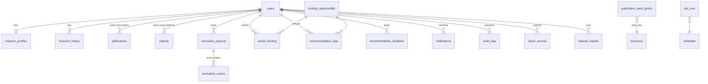

# Architecture & Design Decisions

## 1. System overview

The platform is a three-tier web application: a React single-page app, a FastAPI REST API that hosts every
intelligence module, and a relational database (PostgreSQL in Docker/production, SQLite for zero-setup local
development). Public research/funding APIs are used through small client modules with offline fallbacks.

```mermaid
flowchart LR
    subgraph Users
      R[Researcher]; S[Startup founder]; M[Innovation manager]; A[Administrator]
    end
    subgraph Client["React + Vite + Tailwind SPA"]
      UI[Pages & role dashboards] --> API_CLIENT[axios client + JWT]
    end
    subgraph Backend["FastAPI (Python 3.13)"]
      AUTH[Auth / RBAC / OAuth2]
      PROF[Profile mgmt]
      FUND[Funding discovery]
      REC[Recommender TF-IDF + eligibility]
      RES[Research trend intelligence]
      PAT[Patent landscape]
      TECH[Technology intelligence]
      SCORE[Innovation scoring engine]
      COMM[Commercialization]
      NOTIF[Alerts + scheduler]
      REP[Reports CSV/XLSX/PDF]
      ADMIN[Admin, audit, datasets, monitoring]
    end
    DB[(PostgreSQL / SQLite<br/>17 tables, Alembic)]
    EXT[[Grants.gov · OpenAlex · Crossref · PatentsView*]]
    SNAP[/data/*.json snapshots/]
    Users --> UI
    API_CLIENT -->|HTTPS JSON /api| Backend
    Backend --> DB
    Backend -.optional live calls.-> EXT
    SNAP -->|seed / fallback| DB
```


`*` PatentsView requires a free API key and is disabled unless configured.

### Mapping to the specification's architecture diagram

| Spec layer / service | Implementation |
|---|---|
| Access layer: web portal, admin dashboard, API clients | React SPA (`frontend/`), role dashboards, admin console, OpenAPI/Swagger at `/docs` for API clients. Mobile app: responsive web UI (no native app — out of scope). |
| 1. User & profile management | `api/routes/auth.py`, `users.py`, `profile.py`; models `User`, `ResearchProfile`, `ResearchHistoryEntry` |
| 2. Funding discovery | `routes/funding.py`, `services/recommender.py`, `services/eligibility.py` |
| 3. Research trend intelligence | `services/research_analytics.py` (+ live OpenAlex) |
| 4. Patent landscape analysis | `services/patent_analytics.py` (+ optional PatentsView) |
| 5. Technology intelligence | `services/technology_intel.py` |
| 6. Innovation scoring engine | `services/scoring.py` |
| 7. Commercialization recommendation | `services/commercialization.py` |
| 8. Notification & alert system | `services/alerts.py`, `services/jobs.py` (asyncio scheduler) |
| 9. Dashboard & analytics | `services/dashboard_service.py`, `services/admin_service.py` |
| 10. Reports & export | `services/reports.py` (pandas → CSV, openpyxl → XLSX, ReportLab → PDF) |
| 11. Security & compliance | bcrypt, JWT, RBAC dependencies, login throttling, audit log, security headers, data export/deletion |
| 12. System management | admin datasets/imports, job runner, integrations status, request metrics |
| Integration services (API gateway, broker, WebSocket) | Simplified: a single FastAPI service behind nginx (reverse proxy for `/api`). No message broker — background jobs run in-process (see trade-offs). Notifications are polled every 60 s instead of WebSockets. |
| Data layer (relational, document, vector DB, data lake) | Relational only (PostgreSQL/SQLite with JSON columns). TF-IDF matrices are computed in memory and cached; no separate vector DB is required at this data scale. |
| AI/ML & analytics layer | scikit-learn TF-IDF, cosine similarity, K-means, truncated SVD, silhouette; pandas/NumPy aggregations |
| Infrastructure & DevOps | Dockerfiles + Docker Compose, GitHub Actions CI (SQLite tests, PostgreSQL migration+seed, frontend build). Kubernetes/ELK/Prometheus are documented as future work. |

## 2. Backend structure

```
backend/
  app/
    main.py                 FastAPI app, middleware, lifespan (scheduler), exception handlers
    api/router.py           mounts all routers under /api (+ /api/health)
    api/routes/             auth, users, profile, funding, intelligence (recommendations, research,
                            patents, technology), innovation (+ commercialization), engagement
                            (dashboard, notifications, reports), admin
    core/                   config (pydantic-settings), security (bcrypt/JWT/throttle), deps (RBAC),
                            taxonomy (shared vocabularies), monitoring (metrics + security headers)
    db/                     declarative base + naming convention, engine/session
    models/                 SQLAlchemy 2.0 typed models (17 tables)
    schemas/                Pydantic v2 request/response models
    services/               business logic (one module per platform module) + external/ API clients
    ml/                     text vectorisation helpers, numeric helpers (CAGR, min-max)
    seed/seed.py            idempotent seeding from ../data + demo accounts/projects
  alembic/                  migrations (0001_initial_schema)
  scripts/                  snapshot builder (live APIs) and illustrative-data generator
  tests/                    pytest suite (70 tests)
```

## 3. Data model (17 tables)



* Global corpora (`publications`, `patents` with `owner_id IS NULL`) feed analytics; rows with an `owner_id`
  are the user's own profile items.
* List-valued attributes (domains, keywords, countries…) use the portable `JSON` type so the schema works
  unchanged on SQLite and PostgreSQL. The full PostgreSQL DDL is in [`schema_postgresql.sql`](schema_postgresql.sql).
* Every funding record carries `record_type` (`verified` / `illustrative` / `imported` / `internal`),
  `source_name`, `source_url` and `verified_at` for provenance.

## 4. Key algorithms

### 4.1 Funding recommendation (TF-IDF + cosine + eligibility)
1. **Query text** = profile headline/bio + keywords (×2) + taxonomy expansion of the user's domains + titles
   and keywords of the user's publications (or, for project-based matching, the project text).
2. **Document text** = opportunity title (×2) + description + keywords + area names + funder.
3. `TfidfVectorizer(ngram_range=(1,2), sublinear_tf=True, stop_words=English+domain boilerplate)` fitted on
   the opportunity catalogue (cached until the table changes); cosine similarity = dot product of L2-normalised
   rows.
4. **Eligibility rules** (deadline/status, applicant type, country/region incl. EU, career stage) produce a
   checklist with passed / failed / unknown per criterion.
5. `match = 100 × (0.65·(1 − e^(−sim/0.12)) + 0.15·domain_overlap + 0.20·eligibility_score)`; hard rule
   failures are hidden unless *include ineligible* is requested, and for non-empty profiles opportunities with
   cosine < 0.02 and no shared domain are not offered at all (eligibility alone never makes a "match"). Explanations list the top contributing
   n-grams (element-wise product of the two TF-IDF vectors), domain overlap, deadline, amount and eligibility.
6. **Offline evaluation** (admin → recommendation monitoring): one synthetic persona per technology area;
   precision@5 / recall@5 against area-tagged opportunities (0.95 / 0.97 on the shipped data), plus a 12-case
   labelled rule-consistency check for the eligibility engine.

### 4.2 Research trend intelligence
* **Trends:** yearly global publication counts per area from OpenAlex (`group_by=publication_year`),
  5-year CAGR (2-year averaged end points) → rising / stable / declining.
* **Emerging topics:** binary document-frequency of uni/bi-grams in the recent window (last 5 complete years)
  vs the previous 4 years, smoothed growth × √(recent count); generic academic vocabulary removed.
* **Hotspots:** K-means on TF-IDF of titles/keywords/abstracts; score = 40 % log-citation impact + 40 % recent
  share + 20 % size.
* **Live trend:** any free-text query against OpenAlex, falling back to the local sample when unavailable.

### 4.3 Patent landscape
Search/filter, filing trends (pandas pivot), assignee ranking, competitor comparison (2–5 assignees),
TF-IDF + K-means clustering with *k* chosen by cosine silhouette (3–8) and a 2-D truncated-SVD projection
("innovation map"), domain × assignee heat-map and top-5 similar patents.

### 4.4 Technology intelligence
Per area: publication CAGR, patent CAGR, patent density (patents ÷ publications), assignee diversity, active
funding. Min-max normalised across areas into **maturity**, **emerging**, **adoption** and **opportunity
(white-space)** indices; stages Emerging < 30 ≤ Growing < 50 ≤ Maturing < 70 ≤ Established.

* maturity = 35 % patent density + 25 % patent volume + 25 % log publication volume + 15 % (1 − publication growth)
* emerging = 60 % publication CAGR + 40 % patent CAGR
* adoption = 50 % assignee diversity + 50 % patents filed in the last three years
* opportunity = 45 % publication CAGR + 30 % (1 − patent density) + 25 % active funding

### 4.5 Innovation score (heuristic decision support)
`Score = 0.30·Novelty + 0.20·Patent strength + 0.15·Maturity + 0.20·Market potential + 0.15·Funding relevance`

| Component | Signals |
|---|---|
| Research novelty | 60 % textual novelty (1 − mean top-5 TF-IDF similarity to the publication corpus / 0.5), 25 % domain publication growth, 15 % emerging-term alignment |
| Patent strength | 55 % own IP ((granted + 0.5·pending)/3), 15 % citations of profile patents, 30 % freedom-to-operate proxy (1 − top-3 similarity to existing patents / 0.7) |
| Technology maturity | 80 % TRL ((TRL−1)/8), 20 % pipeline stage |
| Market potential | 55 % market size class, 25 % domain adoption & funding signal, 10 % industry partner, 10 % defined target market |
| Funding relevance | 70 % mean of top-3 eligible match scores, 30 % number of matches ≥ 50 |

Bands: High ≥ 75, Promising ≥ 60, Developing ≥ 40, Early < 40. The UI always shows the component breakdown,
the factors behind each component and a disclaimer that the score is **not** a validated prediction.

### 4.6 Commercialization
Pathway fit scores are weighted combinations of the five components (e.g. licensing = 0.5·P + 0.2·N + 0.15·M +
0.15·mid-maturity). The top pathway (and the runner-up if ≥ 55) is recommended, with rationale, next steps,
domain-specific productization idea starters, licensing targets (assignees with the most similar patents),
industry/academic partner suggestions, matched funding and risk flags derived from weak components.

## 5. Security
* bcrypt (12 rounds) password hashing; password policy (8–72 chars, letter + digit).
* Stateless JWT (HS256, 8 h default); OAuth2 password flow for Swagger; optional Google/GitHub OAuth2
  authorization-code login with a signed, expiring `state`.
* RBAC via `require_roles(...)` dependencies; object-level checks (owners, managers, admins) for projects,
  profile items, saved funding and notifications. Self-registration as admin is impossible; admins cannot
  demote/deactivate themselves; the last admin cannot delete their account.
* Login throttling (5 failures / 5 min per e-mail), audit log of security-relevant actions, security headers,
  CORS allow-list, upload size/row limits, parameterised SQL via SQLAlchemy, LIKE-pattern escaping.
* Privacy: users can export all personal data (JSON) and anonymise/deactivate their account.
* Production guard: the API refuses to start with a weak/default `SECRET_KEY` when `ENVIRONMENT=production`.

## 6. Design decisions & trade-offs

| Decision | Rationale |
|---|---|
| Single FastAPI service instead of microservices | One developer, one deployable; modules are separated by package boundaries and could be split later. |
| TF-IDF instead of transformer embeddings | Required by the brief, explainable (term-level reasons), CPU-only, millisecond latency at this scale. Sentence-Transformers/FAISS remain an upgrade path. |
| In-process asyncio scheduler | Avoids Celery/Redis for a capstone; jobs are idempotent and recorded in `job_runs`. Run it in one instance only. |
| JSON columns for lists | Portable across SQLite/PostgreSQL; queries use a dialect-neutral `CAST(... AS VARCHAR) LIKE` membership test. |
| Bundled snapshots + optional live APIs | The app works offline and reproducibly; admins can refresh from Grants.gov/OpenAlex on demand. |
| Synthetic (illustrative) patents | No free keyless patent API exists; records are clearly labelled and real exports (Google Patents / Lens CSV) can be imported. |
| Polling for notifications | Simpler than WebSockets; 60 s polling is adequate for deadline/alert use-cases. |
| Naive-UTC timestamps | Identical behaviour on SQLite and PostgreSQL; serialised with an explicit `Z`. |
